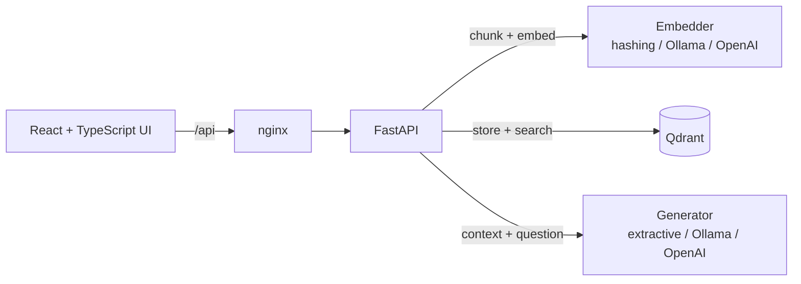

# ragdesk

**Ask questions about your documents and get answers that cite the exact source and page.**

ragdesk is a full-stack retrieval-augmented generation (RAG) app: upload PDFs, Markdown or text files, and ask questions in plain language. Answers are grounded in your documents, with numbered citations you can click to see the passage they came from.


**Stack:** Python · FastAPI · Qdrant (vector DB) · React · TypeScript · Vite · Docker · Docker Compose · GitHub Actions · pytest · Vitest · Ollama / any OpenAI-compatible LLM

## Highlights

- **RAG pipeline** – page-aware chunking with overlap, vector search in Qdrant, prompt that forces the model to cite passages as `[1]`, `[2]`.
- **Pluggable models** – runs fully offline by default; switch to a local LLM (Ollama) or a hosted API (OpenAI-compatible) with environment variables only.
- **Retrieval evaluation** – a golden question set measures **Hit@k** and **MRR**; CI fails if retrieval quality drops below a threshold.
- **Tested** – 20 backend tests (unit + API) at 93% coverage, plus frontend unit tests.
- **Containerized** – multi-stage Docker images (non-root, health checks) and a one-command Docker Compose stack.
- **CI/CD** – GitHub Actions runs linting, tests, the evaluation gate, image builds and an end-to-end smoke test on every push and pull request.

## Architecture



**Ingest:** file → text per page → overlapping word chunks (never spanning pages, so citations stay exact) → embeddings → Qdrant with document and page metadata.
**Ask:** question → embedding → top-k chunks → numbered context → LLM answer with citations → sources returned to the UI.

## Quick start

```bash
docker compose up --build
```

Open http://localhost:8080, upload a document, ask a question. API docs (Swagger) are at http://localhost:8000/docs.

The default setup needs no model or API key: it uses a deterministic hashing embedder and an extractive answerer that returns the most relevant sentences with citations.

### Use a real LLM (local, free)

```bash
LLM_PROVIDER=openai EMBEDDING_PROVIDER=openai EMBEDDING_DIM=768 \
  docker compose --profile llm up --build
docker compose exec ollama ollama pull llama3.2
docker compose exec ollama ollama pull nomic-embed-text
```

### Use a hosted API

Set `OPENAI_BASE_URL`, `OPENAI_API_KEY`, `LLM_MODEL`, `EMBEDDING_MODEL` and `EMBEDDING_DIM` for any OpenAI-compatible provider.

> Changing the embedding provider or dimension requires a fresh collection: `docker compose down -v`.

## Development

```bash
# Backend
cd backend
python -m venv .venv && source .venv/bin/activate
pip install -e ".[dev]"
pytest --cov=app           # tests + coverage
ruff check . && ruff format --check .
uvicorn app.main:app --reload

# Frontend (proxies /api to localhost:8000)
cd frontend
npm install
npm test
npm run dev                # http://localhost:5173
```

## Evaluation

`backend/eval` holds a small corpus and a golden set of questions with the document that should answer each one.

```bash
cd backend
python -m eval.run_eval --k 3 --min-hit-rate 0.8
```

| Embedder | Hit@3 | MRR |
|---|---|---|
| Hashing (offline default), raw Markdown | 0.917 | 0.917 |
| Hashing (offline default), Markdown syntax stripped | **1.000** | **0.944** |

Stripping Markdown syntax during ingestion removed noise tokens and fixed the one retrieval miss. The hashing embedder only captures word overlap, so it struggles with paraphrased questions; a neural embedder (e.g. `nomic-embed-text`) is the next step and can be compared with the same script.

## API

| Method | Path | Description |
|---|---|---|
| `GET` | `/health` | Liveness check |
| `POST` | `/documents` | Upload and index a `.pdf`, `.md` or `.txt` file (max 20 MB) |
| `GET` | `/documents` | List indexed documents with chunk counts |
| `DELETE` | `/documents/{id}` | Remove a document and its chunks |
| `POST` | `/ask` | `{"question": "...", "top_k": 4}` → answer + cited sources |

## Project structure

```
backend/
  app/            FastAPI app, ingestion, embeddings, vector store, generators, pipeline
  tests/          pytest unit + API tests
  eval/           golden set, sample corpus, Hit@k / MRR evaluation script
frontend/
  src/            React + TypeScript UI and typed API client
.github/workflows CI: lint, tests, eval gate, Docker build, smoke test
docker-compose.yml
```

## Roadmap

- Hybrid search (BM25 + vectors) and a cross-encoder re-ranker
- Answer-level evaluation (faithfulness, citation accuracy) with an LLM judge
- Streaming responses
- OCR for scanned PDFs

## License

MIT © Kareem Sayed
